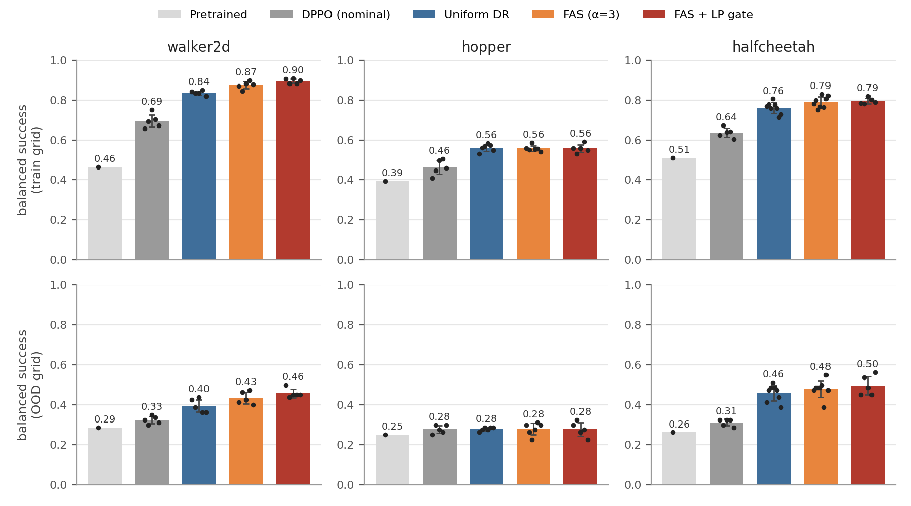

# When Does Failure-Aware Sampling Help? Robust Diffusion Policy Fine-Tuning under Dynamics Disturbances

**16-831 Introduction to Robot Learning (Fall 2026), Carnegie Mellon University — course project**<br>
Jingshu Peng, Binghong Chen, Yi Ni, Arshbir Banipal, Zhenghao Jin

[[Report (draft)](report/main.pdf)]&nbsp;&nbsp;[[Code & reproduction](#what-was-added)]&nbsp;&nbsp;[[Detailed results](REPORT_RESULTS.md)]

This repository is a fork of [DPPO](https://github.com/irom-princeton/dppo) (Ren et al., ICLR 2025).
We fine-tune DPPO's pretrained diffusion policies under randomized dynamics (torso mass × ground friction × random pushes, 36 condition bins) and replace uniform domain randomization with **Failure-Aware Sampling (FAS)**: the condition sampler draws bins in proportion to their recent failure rate,

$$p(c) = \beta \frac{(f_c + \delta)^\alpha}{\sum_{c'} (f_{c'} + \delta)^\alpha} + \frac{1-\beta}{|\mathcal{C}|}.$$

Only the sampler changes; the PPO update, hyperparameters and budget are identical to the uniform baseline (`fas.beta=0`).

**Main findings** (MuJoCo hopper / walker2d / halfcheetah, 16M env steps per run, at least 5 seeds per method):
- FAS improves robustness, worst-case success and learning speed **when the conditions it focuses on are learnable** (walker2d; a smaller gain on halfcheetah), and on walker2d the gain persists under sparse reward. Two post-hoc learnability gates (LP, cumulative progress) do not fix hopper: its hardest bins improve slowly rather than not at all.
- When the failed conditions are unlearnable within the budget (hopper's 300 N pushes), FAS wastes samples and gives no gain. On a grid without them FAS gives a significant gain, as predicted before training (supporting, not isolating, learnability). Critic error does not increase under FAS.
- Imitating the successes that RL discovered (RFT) recovers most of RL's gain on walker2d (78–85%) but only about half on hopper and halfcheetah. Imitation itself is not the bottleneck: BC on the final RL policy's successes matches RL on all three tasks; RFT falls short largely because many of its successes come from earlier policies.



Results in the report and in `REPORT_RESULTS.md` are produced by `scripts/fas/report_figs.py` from the evaluation results; the sections below describe the code and how to reproduce them.

**Attribution.** Built on [DPPO](https://github.com/irom-princeton/dppo) by Ren et al. (MIT license, see [LICENSE](LICENSE)). Its original README, including installation details for the other DPPO tasks, is in [docs/DPPO_README.md](docs/DPPO_README.md).

## What was added

| File | Purpose |
|---|---|
| `util/fas.py` | `ConditionSpace` (grid of bins C), `FailureAwareSampler` (EMA score Eq. 1, p(c) Eq. 2), `episode_success` |
| `env/gym_utils/wrapper/mujoco_disturbance.py` | Env wrapper. On each reset it picks a bin (schedule → probs), sets torso mass / ground friction / random torso pushes, and reports the episode outcome in `info` |
| `agent/finetune/train_ppo_diffusion_fas_agent.py` | DPPO agent + FAS. Pushes p(c) to envs each iteration, updates s_c from finished episodes, logs `fas/*` |
| `agent/eval/eval_diffusion_disturbance_agent.py` | Evaluates any checkpoint on a fixed test grid, N episodes per bin, and writes `result.json` |
| `cfg/gym/finetune/<task>/ft_ppo_diffusion_mlp_{fas,uniform}.yaml` | Inherit **all** DPPO hyperparameters from the upstream `ft_ppo_diffusion_mlp.yaml` |
| `cfg/gym/eval/<task>/eval_diffusion_mlp_disturbance{,_ood}.yaml` | Test grids: the training grid, plus held-out values for generalization |
| `scripts/fas/*` | Setup, launch, evaluation, plotting, summary |
| `tests/test_fas.py` | Tests for the sampler math, the wrapper (against a fake MuJoCo env), config composition and agent hooks |

Small changes to upstream code:

1. `train_ppo_diffusion_agent.py` gets three no-op hooks: `on_iteration_start`, `on_env_step` and `on_rollout_end`.
2. `make_async` always applies `multi_step` as the outermost wrapper.
3. `.gitignore` no longer ignores `scripts/fas/*.sh`.

**Fair comparison by construction:** the *uniform* baseline is the same agent with `fas.beta=0`.
The two arms share the wrappers, bins, seeds, budget and hyperparameters.

## Methods

| method | config | training conditions |
|---|---|---|
| `dppo` | `ft_ppo_diffusion_mlp` (upstream) | nominal env only. This is the DPPO reproduction |
| `uniform` | `ft_ppo_diffusion_mlp_uniform` | 36 disturbance bins, p(c) = 1/36 |
| `fas` | `ft_ppo_diffusion_mlp_fas` | 36 bins, p(c) from Eq. 2 (default α=1, β=0.5, δ=0.05) |

Bins: torso mass ×{0.75, 1.0, 1.25, 1.5} × friction ×{0.5, 1.0, 1.5} × push force {0, 150, 300} N.

**hopper uses grid v2: friction ×{0.5, 1.0, 1.15}.** In grid v1, friction ≥1.25 was a cliff: 0–10% success for the pretrained, uniform and FAS policies alike, so 12 of 36 bins were unlearnable and FAS spent its extra samples there. The v2 OOD grid uses friction {0.35, 1.2} and push {0, 375} N. Run names carry `_gv2`.
Pushes happen with probability 0.01 per step and last 5 steps.

**Success:**
- hopper and walker2d (main experiments): `criterion: survive_steps`. The robot must not fall within the first `min_steps` env steps: 300 for hopper, 500 for walker2d.
  - Why: the pretrained hopper-medium policy falls before 1000 steps in *every* bin, including nominal (median ~470 steps). With the strict criterion all s_c = 1 and FAS reduces to uniform.
  - With L=300, 19 of 36 bins have intermediate success (2 always succeed, 15 always fail).
  - The strict version (`fas.success.criterion=survive`, i.e. reach the 1000-step limit) is kept as the sparse-signal setting for RQ2.
  - walker2d (pretrained, 36 bins): L=300 → 81% success with 10 saturated bins; **L=500 → 49% success, 34 of 36 bins intermediate**; L=1000 → 18%.
  - Pretrained hopper with L=300: 26% balanced success. Friction ×1.5 is hardest (0%), pushes of 300 N drop success to 7%, and mass matters least.
- halfcheetah: return ≥ `return_threshold` = 4000. Calibrated on the pretrained policy: returns are bimodal (flips ~800, otherwise 4000–4700); 4000 gives 57% success, 28/36 bins intermediate. Pushes of 300 N are the main difficulty.

**FAS score updates:**
- At eval iterations (every `val_freq`=10), the deterministic policy runs a round-robin over all bins.
- At train iterations, the stochastic policy samples bins from p(c).
- Both kinds of episode update s_c by default (`fas.update_from`).

## Setup (Linux + NVIDIA GPU; MuJoCo/mujoco_py does not work on Apple Silicon)

**Install:** run `bash scripts/fas/setup_linux.sh [ROOT]`.
It needs no sudo and writes nothing outside ROOT. It installs Miniforge and MuJoCo 2.1 into ROOT, plus a `ROOT/activate.sh`. Afterwards:

```bash
source ROOT/activate.sh                     # conda env + MuJoCo + DPPO_* paths, cd into the repo
export DPPO_WANDB_ENTITY=<team>             # optional; without it wandb=null
```

Pick a free GPU with `CUDA_VISIBLE_DEVICES=<id>` (check `nvidia-smi` first) and use `tmux` for long runs.
We ran everything on a shared Linux server with 4 NVIDIA GPUs and 256 CPU cores, installed under `ROOT=~/dppo_fas` (the path the launch scripts use).

The pretrained checkpoints and normalization files download automatically on the first run.

## Step 1: reproduce DPPO

```bash
# pretrained policy, nominal env (upstream eval)
python script/run.py --config-dir=cfg/gym/eval/hopper-v2 --config-name=eval_diffusion_mlp
# DPPO fine-tuning, nominal env
bash scripts/fas/finetune.sh hopper-v2 dppo 0
# quick smoke test (a few minutes)
N_ITR=5 bash scripts/fas/finetune.sh hopper-v2 fas 0 env.n_envs=4 train.n_steps=50 train.val_freq=2
```

Check the eval episode return against the DPPO paper and `cfg/finetuning.md`, Gym section.
Upstream configs run 1000 iterations (80M env steps).
Our scripts default to `N_ITR=200` (16M steps), which matches the proposal's *limited budget*.

## Step 2: RQ1, DPPO vs DPPO-uniform vs DPPO-FAS

```bash
bash scripts/fas/sweep_rq1.sh hopper-v2 "0 1 2"     # 3 methods x 3 seeds, same budget
python scripts/fas/plot_compare.py $DPPO_LOG_DIR/gym-finetune --task hopper-medium-v2 --out hopper.png

# final test on identical conditions (train grid + held-out grid)
for G in train ood; do
  bash scripts/fas/evaluate.sh hopper-v2 pretrained $G
  for CK in $DPPO_LOG_DIR/gym-finetune/hopper-medium-v2_*/*/checkpoint/state_199.pt; do
    bash scripts/fas/evaluate.sh hopper-v2 $CK $G
  done
done
python scripts/fas/summarize_eval.py $DPPO_LOG_DIR/gym-eval-disturbance --csv rq1.csv
```

Main metrics:
- `balanced_success`: mean of per-bin success
- `worst_bin_success`
- the same two for return
- sample efficiency: the `fas/eval/balanced_success` curve against env steps

## Step 3: RQ2, RQ3, extra conditions

- **Figures and tables:** `python scripts/fas/report_figs.py --out figs` writes everything into `figs/`:
  - `fig_curves`, `fig_final`, `fig_bins`: RQ1 on 3 tasks;
  - `sample_efficiency.csv`: per-seed AUC with Welch t, and iterations to a fixed threshold;
  - `fig_rq3`: RL vs RFT;
  - `fig_hard`: the harder walker2d grid;
  - `fig_sparse`: reward sparsity.
- **RQ2: sampling strength and critic error.**
  - `python scripts/fas/rq2_critic.py <run_dir> <itr>` measures per-bin critic error against the Monte-Carlo return.
  - `python scripts/fas/rq2_analysis.py --critic-dir ~/dppo_fas/rq2` reports:
    - sampling concentration;
    - the α=1 vs α=3 comparison;
    - success on the worst 25% of bins;
    - critic error by difficulty group.
  - Output: `figs/rq2_analysis.txt`.
- **RQ2: reward sparsity.** `++env.wrappers.mujoco_disturbance.reward_delay=K` accumulates the dense reward and pays it every K env steps and at episode end. The episode return does not change, and `fas_ep_return` stays dense.
- **Harder grid** (walker2d): override `env.wrappers.mujoco_disturbance.condition_space.{mass_scale=[1.0,1.25,1.5,1.75],friction_scale=[0.35,0.5,1.0],impulse_force=[150.0,300.0,450.0]}` for training. For eval, use the same overrides plus `eval_grid=hard`, which writes to a separate eval dir.
- **RQ3 (RFT):**
  1. Set `fas.save_success_trajs=True` during fine-tuning.
  2. Run `cfg/gym/rft/<env>/rft_diffusion_mlp.yaml`. It is diffusion BC from the EMA weights on the successful train episodes, with actions clipped to the executed ±1. `demo_weight` mixes in D4RL demos.
- **LEGO:** a new env and wrapper that implement the same `set_condition_probs` / `set_condition_schedule` / `fas_ep_*` interface. The agent itself is env-agnostic apart from the wrapper-name assert.

## Adapting to a new task or grid

1. **Disturbance strength.** First evaluate the pretrained policy on the train grid. Hard bins should fail often and easy bins should mostly succeed. If every bin is 0% or 100%, FAS has nothing to prioritize. Then adjust `condition_space`, `impulse_prob` and `impulse_duration`.
2. **Success criterion.** Calibrate the threshold the same way (we used survival for 500 / 300 steps on walker2d / hopper and a return of 4000 on halfcheetah).
3. **Coverage.** Each eval iteration gives about 1–3 episodes per bin with 40 envs, which is noisy. The EMA (`ema_rate`) smooths it, and `train.val_freq` controls how often eval happens.

## Known upstream quirks (left unchanged)

- `MultiStep` reports `terminated=True` on time-limit truncation as well. The disturbance wrapper therefore tracks falls itself (`fas_ep_terminated`). As a side effect, PPO's GAE (`nonterminal = 1 - terminated`) treats the 1000-step limit as a real terminal state. The critic is trained toward return-to-episode-end, but it has no time feature. That leaves an irreducible error in bins where the policy survives to the limit, which is why `rq2_critic.py` uses the same target. This is the same for every method, so we leave it as is.
- The upstream gym eval configs for walker2d and halfcheetah have a wrong or empty `base_policy_path`. Our `eval_diffusion_mlp_disturbance` configs set the correct one.
- **The pretrained baseline must be the EMA weights.** DPPO fine-tuning starts from the pretrained checkpoint's `ema` weights (`DiffusionModel` loads `ema` when it is present). The eval model (`model/diffusion/diffusion_eval.py`) reads `model` instead, which holds the raw weights. So `evaluate.sh <task> pretrained` scores a different policy than the one DPPO starts from. On our disturbance grids the two differ a lot (train-grid balanced success, raw → EMA): walker2d 0.808 → 0.464, halfcheetah 0.758 → 0.511, hopper v2 0.381 → 0.394. Report the EMA numbers as "pretrained (DPPO init)". To get them, run `python scripts/fas/export_pretrained_ema.py` and evaluate `$DPPO_LOG_DIR/gym-pretrain-ema/<env>_pre_diffusion_mlp_ema/ckpt_0/checkpoint/state_3000.pt`. RFT starts from the same EMA weights.
- **CPU pinning (machine-specific):** on our server, the cores of one CPU socket were throttled to 400 MHz, and runs whose main process landed there were about 5× slower. The launch scripts therefore pin to the other socket with `taskset -c 64-127,192-255`; remove or adapt this on another machine.
